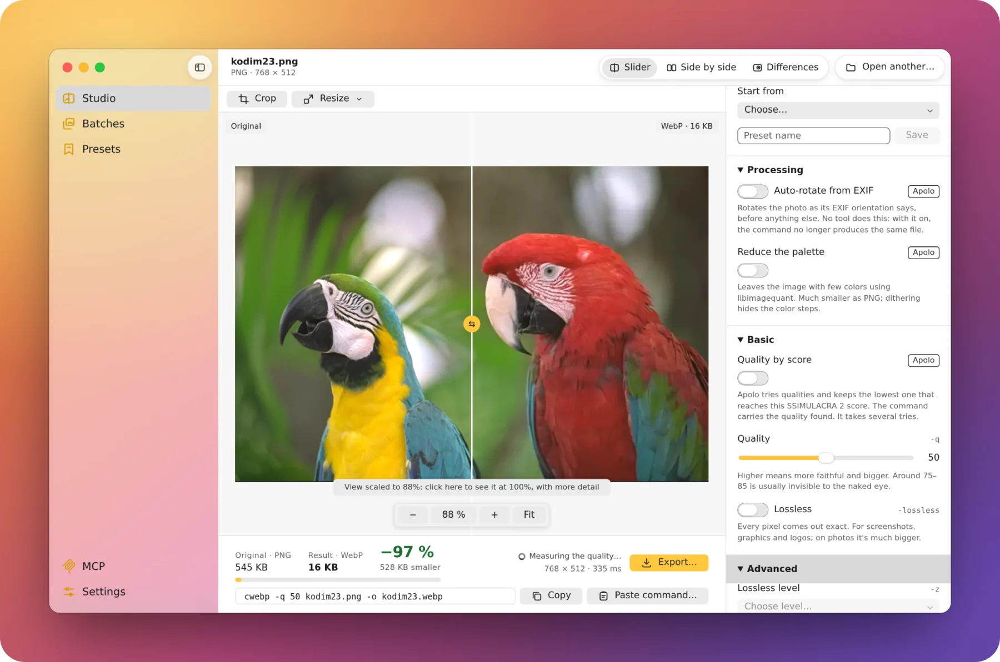
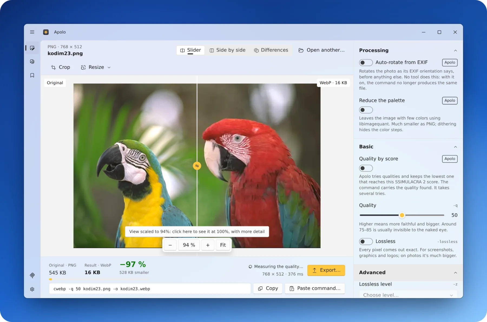
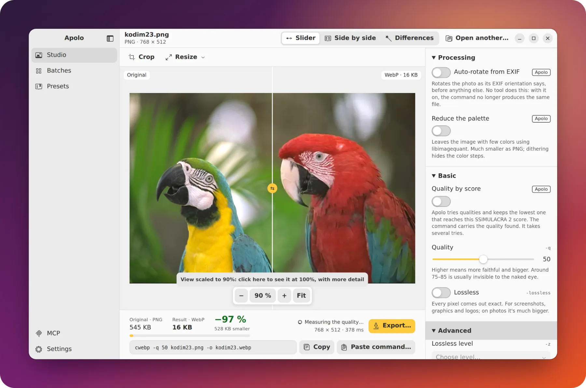
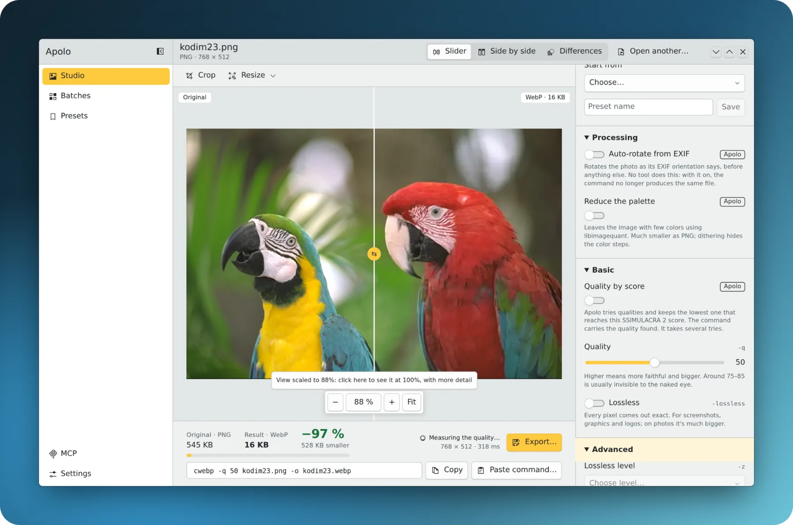

<p align="center">
  
</p>

<h1 align="center">Apolo</h1>

<p align="center">
  <strong>Lighter images, just as good.</strong><br>
  The image optimizer for macOS, Windows and Linux: WebP, AVIF, JPEG XL, JPEG and PNG on your own
  computer, seeing what you lose before you save. Free and open source.
</p>

<p align="center">
  <a href="https://apolo.webcafeina.com/en/download/mac/"></a>
  <a href="https://apolo.webcafeina.com/en/download/windows/"></a>
  <a href="https://apolo.webcafeina.com/en/download/linux/"></a>
</p>

<p align="center">
  <a href="https://github.com/webcafeina/Apolo/releases/latest"></a>
  <a href="https://github.com/webcafeina/Apolo/releases"></a>
  <a href="https://github.com/webcafeina/Apolo/actions/workflows/comprobar.yml"></a>
  <a href="LICENSE"></a>
</p>

<p align="center"><a href="https://apolo.webcafeina.com/en/">apolo.webcafeina.com</a> · <a href="README.md">Español</a></p>

<p align="center">
  <picture>
    <source media="(prefers-color-scheme: dark)" srcset=".github/readme/apolo-macos-oscuro-en.webp">
    
  </picture>
</p>

## Why Apolo

- **See what you lose before you save.** Compare the original and the result with a slider, side by
  side or with a difference map, and Apolo gives you each one's SSIMULACRA 2 score.
- **The same file as the official tools**, byte for byte: `cwebp`, `cjpeg` (MozJPEG), `oxipng`,
  `avifenc` and `cjxl` are inside, with all their options, and Apolo gives you the equivalent
  command.
- **Quality by score.** Ask for no visible loss, and Apolo finds the lowest quality that gets there,
  photo by photo.
- **Whole folders**: parallel batches, several formats at once, the lightest per photo, one size for
  all, and it never overwrites anything.
- **Crop and resize** on the image, by the longest side, a percentage, or width and height.
- **Opens iPhone photos** (HEIC), plus PNG, JPEG, WebP, AVIF, JPEG XL, TIFF, GIF, BMP, QOI and PNM.
- **Made for each system**: Liquid Glass on macOS, Fluent and Mica on Windows, Adwaita on GNOME and
  Breeze on KDE. In English and Spanish.
- **Private and light**: your images never leave your computer, and with 24-megapixel photos it
  stays around 2 GB of memory.
- **With your AI agent**: Claude, Cursor or VS Code optimize for you through its MCP server.

<table>
  <tr>
    <td></td>
    <td></td>
    <td></td>
  </tr>
  <tr>
    <td align="center">Windows 11</td>
    <td align="center">Ubuntu (GNOME)</td>
    <td align="center">KDE Plasma</td>
  </tr>
</table>

## Download

The easiest way is **[apolo.webcafeina.com](https://apolo.webcafeina.com/en/)**: it knows which
computer you have and gives you its download. Every file is in the
**[latest release](https://github.com/webcafeina/Apolo/releases/latest)**, with its checksum in
`SHA256SUMS.txt`.

| System | App |
|---|---|
| **macOS 11+**, Apple silicon and Intel | universal `.dmg` |
| **Windows 10 and 11**, x64 and ARM | `.exe` installer |
| **Linux**, x64 and ARM | `.deb` (Debian, Ubuntu), `.rpm` (Fedora, openSUSE), AppImage or PKGBUILD (Arch) |

**With Homebrew**, on macOS and Linux:

```sh
brew install --cask webcafeina/apolo/apolo   # the app (macOS)
brew install webcafeina/apolo/apolo          # the command line and the server for agents
```

**On Linux, with the repository** (signed with [Apolo's key](https://apolo.webcafeina.com/apolo.asc)),
it updates with the rest of your system:

```sh
# Debian and Ubuntu
sudo install -dm755 /etc/apt/keyrings
sudo curl -fsSLo /etc/apt/keyrings/apolo.asc https://apolo.webcafeina.com/apolo.asc
sudo curl -fsSLo /etc/apt/sources.list.d/apolo.sources https://apolo.webcafeina.com/apt/apolo.sources
sudo apt update && sudo apt install apolo

# Fedora
sudo curl -fsSLo /etc/yum.repos.d/apolo.repo https://apolo.webcafeina.com/rpm/apolo.repo
sudo dnf install apolo

# openSUSE
sudo zypper addrepo https://apolo.webcafeina.com/rpm/apolo.repo
sudo zypper install apolo

# Arch, Manjaro, EndeavourOS, CachyOS (coming soon to the AUR, as apolo-bin)
mkdir apolo && cd apolo
curl -fsSLO https://apolo.webcafeina.com/aur/PKGBUILD
makepkg -si
```

**It updates itself**: when there's a new version, Apolo tells you and installs it with one click.

**The first time**, since the installers aren't signed, your system warns you:
- **macOS**: in System Settings › Privacy & Security, click “Open Anyway”. If it says it's damaged:
  `xattr -dr com.apple.quarantine /Applications/Apolo.app`.
- **Windows**: in SmartScreen, “More info” › “Run anyway”.

## In the terminal

The `apolo` command line does what the app does, with each official tool's options and the same
presets:

```sh
apolo webp -q 80 photo.png -o photo.webp                     # like cwebp
apolo avif -q 60 photo.png photo.avif                        # like avifenc
apolo lote photos/ --formato webp,avif --objetivo 80         # whole folders, by score
apolo lote photos/ --mas-ligero --formato webp,avif,jpeg --lado-mayor 1920
apolo medir photo.png photo.webp                             # SSIMULACRA 2, PSNR and SSIM
```

More examples on [the command-line page](https://apolo.webcafeina.com/en/cli/).

## With an AI agent

Apolo works from **Claude, Cursor, VS Code** and any agent that speaks
[MCP](https://modelcontextprotocol.io): it analyzes, optimizes, compares formats at the same
perceived quality, measures the loss and converts folders, on your computer. **It never overwrites or
deletes.**

The server, `apolo-mcp`, lives inside the app and updates with it. In Apolo, the **MCP** row in the
sidebar has what to copy for each agent and the Claude Desktop extension. For Claude Code:

```sh
claude mcp add --scope user apolo -- "/Applications/Apolo.app/Contents/MacOS/apolo-mcp"   # macOS
claude mcp add --scope user apolo -- "%LOCALAPPDATA%\Apolo\apolo-mcp.exe"                  # Windows
claude mcp add --scope user apolo -- /usr/bin/apolo-mcp                                    # Linux
```

The tools are in [docs/mcp/catalogo.md](docs/mcp/catalogo.md) (in Spanish). What the agent asks for
(paths, names, thumbnails) goes into its conversation, and the model provider sees it.

## Questions

Is it free? Does it upload my images? Why does my system warn me? The answers are in
[the FAQ](https://apolo.webcafeina.com/en/faq/). And what each version brings, in
[what's new](https://apolo.webcafeina.com/en/whats-new/).

## Building

You need:
- stable Rust, Node 22 and pnpm;
- CMake, nasm and clang (libjxl is built with clang, like the official `cjxl`);
- on Linux, also `libwebkit2gtk-4.1-dev librsvg2-dev libssl-dev pkg-config`.

Clone with submodules: `git clone --recurse-submodules`.

```sh
make comprobar     # formatting, clippy, tests, interface and website
make equivalencia  # the same file as cwebp, cjpeg, oxipng, qoiconv, avifenc and cjxl
make cli           # the command line
make mcp           # the server for agents, apolo-mcp
make app           # the app (with apolo-mcp inside)
```

## License

[GPLv3](LICENSE). Apolo is free software: you can use, study, change and share it. The engines inside
have their own licenses, all compatible:

| License | Engines |
|---|---|
| BSD | libwebp, MozJPEG, libavif, aom, libyuv and libjxl |
| MIT | OxiPNG |
| GPLv3 | libimagequant |
| LGPLv3 | libheif and libde265 |
| Apache-2.0 | highway, sjpeg and rmcp |
| MIT or Apache-2.0 | sys-locale |

Made by [Webcafeína](https://webcafeina.com/?utm_source=github&utm_medium=readme&utm_campaign=apolo).
