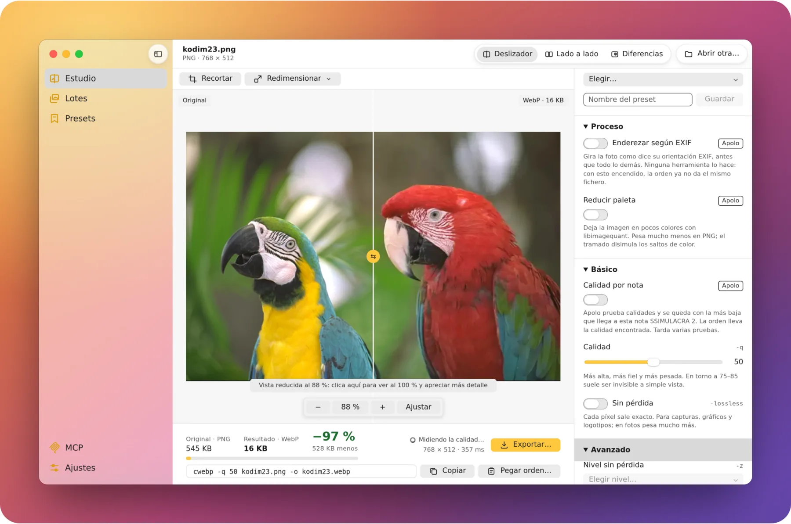
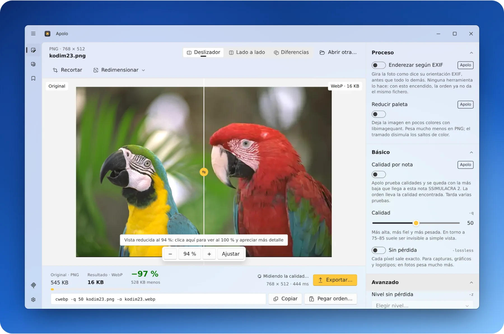
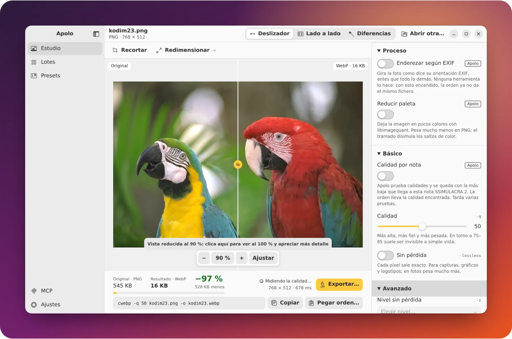
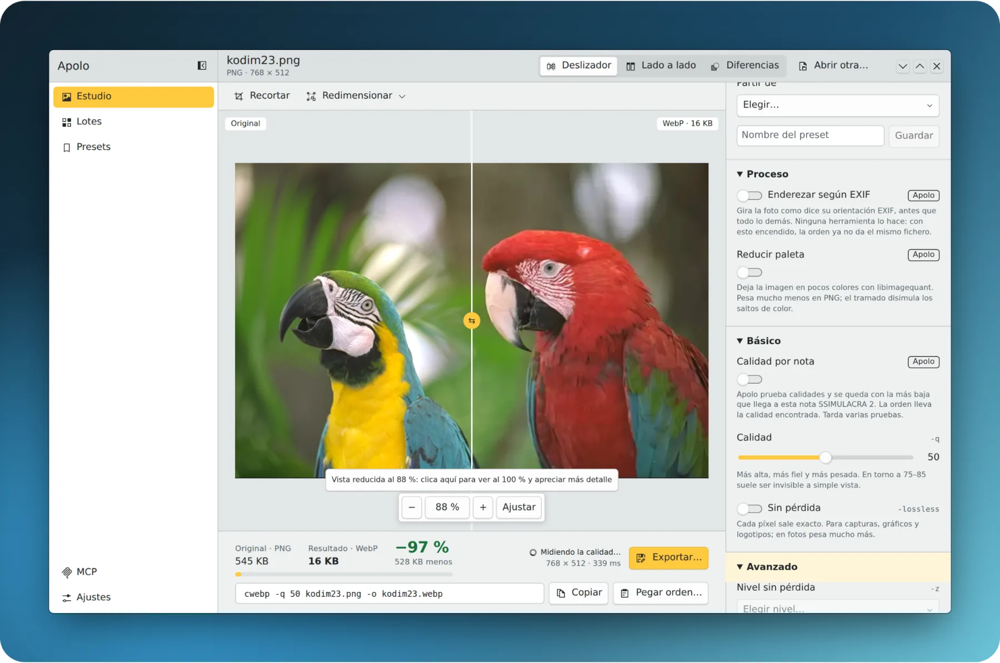

<p align="center">
  
</p>

<h1 align="center">Apolo</h1>

<p align="center">
  <strong>Imágenes más ligeras, igual de buenas.</strong><br>
  El optimizador de imágenes para macOS, Windows y Linux: WebP, AVIF, JPEG XL, JPEG y PNG en tu
  ordenador, viendo lo que pierdes antes de guardar. Gratis y de código abierto.
</p>

<p align="center">
  Comprime imágenes y conviértelas a WebP, AVIF o JPEG XL sin subirlas a ningún sitio: de una en
  una, por carpetas, desde la terminal o con tu agente de IA.
</p>

<p align="center">
  <a href="https://apolo.webcafeina.com/descargar/mac/"></a>
  <a href="https://apolo.webcafeina.com/descargar/windows/"></a>
  <a href="https://apolo.webcafeina.com/descargar/linux/"></a>
</p>

<p align="center">
  <a href="https://github.com/webcafeina/Apolo/releases/latest"></a>
  <a href="https://github.com/webcafeina/Apolo/releases"></a>
  <a href="https://github.com/webcafeina/Apolo/actions/workflows/comprobar.yml"></a>
  <a href="LICENSE"></a>
</p>

<p align="center"><a href="https://apolo.webcafeina.com">apolo.webcafeina.com</a> · <a href="https://apolo.webcafeina.com/guias/">Guías</a> · <a href="https://apolo.webcafeina.com/comparativas/">Comparativas</a> · <a href="README.en.md">English</a></p>

<p align="center">
  <picture>
    <source media="(prefers-color-scheme: dark)" srcset=".github/readme/apolo-macos-oscuro.webp">
    
  </picture>
</p>

## Por qué Apolo

- **Ves lo que pierdes antes de guardar.** Comparas el original y el resultado con un deslizador,
  lado a lado o con un mapa de diferencias, y Apolo te da la nota SSIMULACRA 2 de cada uno.
- **El mismo fichero que las herramientas oficiales**, byte a byte: `cwebp`, `cjpeg` (MozJPEG),
  `oxipng`, `avifenc` y `cjxl` van dentro, con todas sus opciones, y Apolo te da la orden
  equivalente.
- **Calidad por nota.** Pide que no se note, y Apolo busca la calidad más baja que lo consigue, foto
  a foto.
- **Carpetas enteras**: lotes en paralelo, varios formatos a la vez, el más ligero de cada foto, un
  tamaño para todas, y nunca sobrescribe nada.
- **Recortar y redimensionar** sobre la imagen, por el lado mayor, un porcentaje o ancho y alto.
- **Abre las fotos del iPhone** (HEIC), además de PNG, JPEG, WebP, AVIF, JPEG XL, TIFF, GIF, BMP,
  QOI y PNM.
- **Hecha para cada sistema**: Liquid Glass en macOS, Fluent y Mica en Windows, Adwaita en GNOME y
  Breeze en KDE. En español y en inglés.
- **Privada y ligera**: tus imágenes no salen de tu ordenador, y con fotos de 24 megapíxeles no pasa
  de unos 2 GB de memoria.
- **Con tu agente de IA**: Claude, Cursor o VS Code optimizan por ti con su servidor MCP.

<table>
  <tr>
    <td></td>
    <td></td>
    <td></td>
  </tr>
  <tr>
    <td align="center">Windows 11</td>
    <td align="center">Ubuntu (GNOME)</td>
    <td align="center">KDE Plasma</td>
  </tr>
</table>

## Descargar

La forma más fácil es **[apolo.webcafeina.com](https://apolo.webcafeina.com)**: sabe qué ordenador
tienes y te da su descarga. Todos los ficheros están en la
**[última versión](https://github.com/webcafeina/Apolo/releases/latest)**, con su suma en
`SHA256SUMS.txt`.

| Sistema | Aplicación |
|---|---|
| **macOS 11+**, Apple Silicon e Intel | `.dmg` universal |
| **Windows 10 y 11**, x64 y ARM | instalador `.exe` |
| **Linux**, x64 y ARM | `.deb` (Debian, Ubuntu), `.rpm` (Fedora, openSUSE), AppImage o PKGBUILD (Arch) |

**Con Homebrew**, en macOS y Linux:

```sh
brew install --cask webcafeina/apolo/apolo   # la aplicación (macOS)
brew install webcafeina/apolo/apolo          # la línea de comandos y el servidor para agentes
```

**En Linux, con el repositorio** (firmado con [la clave de Apolo](https://apolo.webcafeina.com/apolo.asc)),
se actualiza con el resto del sistema:

```sh
# Debian y Ubuntu
sudo install -dm755 /etc/apt/keyrings
sudo curl -fsSLo /etc/apt/keyrings/apolo.asc https://apolo.webcafeina.com/apolo.asc
sudo curl -fsSLo /etc/apt/sources.list.d/apolo.sources https://apolo.webcafeina.com/apt/apolo.sources
sudo apt update && sudo apt install apolo

# Fedora
sudo curl -fsSLo /etc/yum.repos.d/apolo.repo https://apolo.webcafeina.com/rpm/apolo.repo
sudo dnf install apolo

# openSUSE
sudo zypper addrepo https://apolo.webcafeina.com/rpm/apolo.repo
sudo zypper install apolo

# Arch, Manjaro, EndeavourOS, CachyOS (pronto en el AUR, como apolo-bin)
mkdir apolo && cd apolo
curl -fsSLO https://apolo.webcafeina.com/aur/PKGBUILD
makepkg -si
```

**Se actualiza sola**: cuando hay una versión nueva, Apolo lo avisa y se instala con un clic.

**La primera vez**, como los instaladores no están firmados, el sistema avisa:
- **macOS**: en Ajustes del Sistema › Privacidad y seguridad, pulsa «Abrir igualmente». Si dice que
  está dañada: `xattr -dr com.apple.quarantine /Applications/Apolo.app`.
- **Windows**: en SmartScreen, «Más información» › «Ejecutar de todos modos».

### Verificar la descarga

Cada fichero de la versión trae su suma SHA-256 en `SHA256SUMS.txt` y su procedencia firmada por
GitHub (qué compilación lo hizo y desde qué commit). Con la [línea de comandos de GitHub](https://cli.github.com):

```sh
gh attestation verify Apolo_1.0.0_universal.dmg --repo webcafeina/Apolo
```

Los repositorios APT y RPM y los `.rpm` van firmados con la clave GPG
`6D95 3C94 D0D6 6AB6 B9B0 FA26 CA21 CD7A B7FA 57FC`. Cómo avisar de un fallo de seguridad, en
[SECURITY.md](SECURITY.md).

## En la terminal

La línea de comandos `apolo` hace lo mismo que la aplicación, con las opciones de cada herramienta
oficial y los mismos presets:

```sh
apolo webp -q 80 foto.png -o foto.webp                       # como cwebp
apolo avif -q 60 foto.png foto.avif                          # como avifenc
apolo lote fotos/ --formato webp,avif --objetivo 80          # carpetas enteras, por nota
apolo lote fotos/ --mas-ligero --formato webp,avif,jpeg --lado-mayor 1920
apolo medir foto.png foto.webp                               # SSIMULACRA 2, PSNR y SSIM
```

Más ejemplos en [la página de la línea de comandos](https://apolo.webcafeina.com/linea-de-comandos/).

## Con un agente de IA

Apolo se usa desde **Claude, Cursor, VS Code** y cualquier agente que hable
[MCP](https://modelcontextprotocol.io): analiza, optimiza, compara formatos a la misma calidad
percibida, mide la pérdida y convierte carpetas, en tu ordenador. **Nunca sobrescribe ni borra.**

El servidor, `apolo-mcp`, va dentro de la aplicación y se actualiza con ella. En Apolo, la fila
**MCP** de la barra lateral tiene lo que hay que copiar para cada agente y la extensión de Claude
Desktop. Para Claude Code:

```sh
claude mcp add --scope user apolo -- "/Applications/Apolo.app/Contents/MacOS/apolo-mcp"   # macOS
claude mcp add --scope user apolo -- "%LOCALAPPDATA%\Apolo\apolo-mcp.exe"                  # Windows
claude mcp add --scope user apolo -- /usr/bin/apolo-mcp                                    # Linux
```

Cómo conectarlo en cada agente, en [la página de agentes](https://apolo.webcafeina.com/agentes/); qué
pedirle, en [la guía](https://apolo.webcafeina.com/guias/optimizar-imagenes-con-un-agente-de-ia/); y
las once herramientas, en [docs/mcp/catalogo.md](docs/mcp/catalogo.md). Lo que el agente pide (rutas,
nombres, miniaturas) entra en su conversación, y lo ve el proveedor del modelo.

## Guías

Con cifras medidas por Apolo sobre 24 fotos de uso libre:

- [Convertir imágenes a WebP](https://apolo.webcafeina.com/guias/convertir-a-webp/)
- [AVIF, WebP o JPEG XL: cuál usar](https://apolo.webcafeina.com/guias/avif-webp-o-jpeg-xl/)
- [Comprimir imágenes sin perder calidad](https://apolo.webcafeina.com/guias/comprimir-imagenes-sin-perder-calidad/)
- [Optimizar imágenes para la web](https://apolo.webcafeina.com/guias/optimizar-imagenes-para-la-web/)
- [Optimizar imágenes con un agente de IA](https://apolo.webcafeina.com/guias/optimizar-imagenes-con-un-agente-de-ia/)
- [Convertir HEIC a JPG](https://apolo.webcafeina.com/guias/heic-a-jpg/)

Y Apolo frente a otras herramientas, en [las comparativas](https://apolo.webcafeina.com/comparativas/).

## Preguntas

¿Es gratis? ¿Sube mis imágenes? ¿Por qué avisa el sistema? Las respuestas, en
[las preguntas frecuentes](https://apolo.webcafeina.com/preguntas/). Y lo que trae cada versión, en
[novedades](https://apolo.webcafeina.com/novedades/).

## Compilar

Hace falta:
- Rust estable, Node 22 y pnpm;
- CMake, nasm y clang (libjxl se compila con clang, como el `cjxl` oficial);
- en Linux, además, `libwebkit2gtk-4.1-dev librsvg2-dev libssl-dev pkg-config`.

Clona con submódulos: `git clone --recurse-submodules`.

```sh
make comprobar     # formato, clippy, pruebas, interfaz y web
make equivalencia  # el mismo fichero que cwebp, cjpeg, oxipng, qoiconv, avifenc y cjxl
make cli           # la línea de comandos
make mcp           # el servidor para agentes, apolo-mcp
make app           # la aplicación (con apolo-mcp dentro)
```

## Licencia

[GPLv3](LICENSE). Apolo es software libre: puedes usarlo, estudiarlo, cambiarlo y compartirlo. Los
motores que lleva dentro tienen sus propias licencias, todas compatibles:

| Licencia | Motores |
|---|---|
| BSD | libwebp, MozJPEG, libavif, aom, libyuv y libjxl |
| MIT | OxiPNG |
| GPLv3 | libimagequant |
| LGPLv3 | libheif y libde265 |
| Apache-2.0 | highway, sjpeg y rmcp |
| MIT o Apache-2.0 | sys-locale |

Hecho por [Webcafeína](https://webcafeina.com/?utm_source=github&utm_medium=readme&utm_campaign=apolo).
